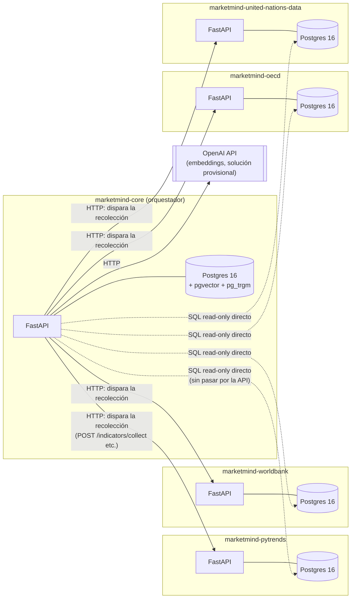

# Arquitectura técnica — stack Python de MarketMind Core

Este documento describe los componentes técnicos que componen `marketmind-core` y cómo se conecta a los otros
4 servicios de MarketMind. No trata sobre el método (Cap. 4/5) — eso está en
`docs/marketmind-capitulo4-metricas.md`/`docs/marketmind-capitulo5-mos.md` y `docs/marketmind-mos-flow-diagram.md`.

## Visión general de la constelación de servicios

MarketMind no es un monolito — son **5 servicios independientes**, cada uno con su propio Postgres:



**Dos formas diferentes de comunicación con los 4 microservicios, a propósito:**
- **HTTP (línea continua):** solo para *disparar la recolección* de dato nuevo (`POST /indicators/collect`, `/interest-over-time`,
  etc.) y consultar el estado de la ejecución (`GET /runs/{id}`).
- **SQL directo, read-only (línea discontinua):** para *leer* el dato ya recolectado a la hora de calcular indicadores —
  usuario Postgres `marketmind_readonly`, creado una vez en cada una de las 4 bases de datos
  (`scripts/create_readonly_roles.sql`), sin permiso de escritura. Decisión de simplicidad (evita reimplementar
  endpoints de lectura que los 4 servicios ya exponen vía tabla) — el costo es acoplamiento de esquema (ver
  `docs/marketmind-transparencia-tecnica.md` para el detalle del riesgo).

## Stack por capa

| Capa | Tecnología | Uso en el proyecto |
|---|---|---|
| Lenguaje | Python 3.12 | `pyproject.toml: python = "^3.12"` |
| Framework web | FastAPI 0.115 | Rutas HTTP, validación de request/response vía Pydantic |
| Servidor ASGI | Uvicorn 0.34 | Ejecuta la aplicación FastAPI |
| ORM | SQLAlchemy 2.0 (modo async) | Modelos, queries, sesiones asíncronas |
| Driver Postgres (app) | asyncpg 0.30 | Driver usado por SQLAlchemy async en runtime |
| Driver Postgres (migrations) | psycopg2-binary 2.9 | Alembic corre en modo sync, usa este driver |
| Migrations | Alembic 1.14 | 7 migrations hasta ahora, una por cada cambio de esquema |
| Validación/serialización | Pydantic 2.10 + pydantic-settings 2.7 | Schemas de request/response, `Settings` cargado desde `.env` |
| Cliente HTTP | httpx 0.28 | Llamadas a las APIs de los 4 microservicios y a OpenAI |
| Retry/backoff | tenacity 9.0 | Usado en los 4 microservicios de recolección (no en el Core directamente) |
| Base de datos | Postgres 16 (`pgvector/pgvector:pg16`) | Uno por servicio — el del Core usa la imagen con pgvector |
| Extensión de vector | pgvector 0.3 (Python) + extensión `vector` (Postgres) | Embedding del catálogo de productos, búsqueda por similitud de coseno |
| Extensión de texto | `pg_trgm` (extensión Postgres) | Similitud de trigram para matching de alias de producto |
| Matemática MCDA (validación) | pymcdm 1.4 | TOPSIS + Entropy Weight *clásicos*, solo para comparación — no decide el MOS de producción |
| Empaquetado/dependencias | Poetry 1.8 | `pyproject.toml` + `poetry.lock` |
| Contenedor | Docker + Docker Compose | Un `docker-compose.yml` por servicio; `Dockerfile` basado en `python:3.12-slim` |
| Lint | Ruff 0.8 (reglas E/F/I/N/W/UP) | `ruff check .` |
| Formateo | Black 24.10 + `ruff format` | Estandarización de estilo |
| Type checking | mypy 1.13, modo `strict` | `mypy app/` — cero errores es requisito antes de cerrar cualquier fase |
| Pruebas | pytest 8.3 + pytest-asyncio 0.24 | `asyncio_mode = "auto"` — pruebas async sin necesidad de decorator |
| Administración de base de datos | pgAdmin 4 | Única instancia compartida entre las 5 bases de datos (`docker-compose.yml` del Core) |

## Arquitectura en capas (Clean Architecture)

```
app/
├── main.py                 # bootstrap de FastAPI, lifespan (conecta/cierra las 5 bases de datos)
├── core/                   # configuración (.env), excepciones propias, logging
├── domain/
│   └── enums.py            # DataSource, IndicatorCode, IndicatorDimension, etc. — vocabulario del dominio
├── db/
│   ├── base.py              # Base declarativa de SQLAlchemy, type_annotation_map (datetime timezone-aware)
│   ├── session.py           # engine + sessionmaker del propio Postgres del Core
│   ├── external.py          # engines read-only para las 4 bases de datos externas (una por fuente)
│   └── models/               # un archivo por tabla (11 tablas)
├── repositories/            # una clase por agregado — solo SQL, ninguna regla de negocio
├── services/                # regla de negocio — orquesta repositorios, no conoce HTTP
│   ├── indicators/            # Cap. 4 — una función de valor bruto por indicador, por fuente
│   └── mos/                   # Cap. 5 — matemática pura (dimension_mapping, roc_weights, topsis, ...)
├── schemas/                 # Pydantic — forma exacta de request/response de cada ruta
└── api/routes/               # FastAPI routers — solo traducción HTTP↔servicio, sin lógica
```

**Regla de dependencia (siempre en esa dirección, nunca al revés):** `api/routes` → `services` → `repositories` →
`db/models`. Una ruta nunca importa un repositorio directamente; un servicio nunca arma una respuesta HTTP.

### Módulos por responsabilidad

| Módulo | Responsabilidad |
|---|---|
| `services/collection_client.py` | Traduce un pedido de recolección genérico al formato HTTP específico de cada una de las 4 fuentes |
| `services/coverage_service.py` | Decide si un dato ya está "fresco" (`coverage_index` + TTL) o necesita recolectarse de nuevo |
| `services/catalog_service.py` | Pipeline de resolución de producto: alias exacto → trigram → embedding → crear entidad nueva |
| `services/embedding_client.py` | Llamada aislada a la API de embeddings (OpenAI, vía `httpx` puro) |
| `services/indicator_engine.py` | Orquesta el cálculo de los 17 indicadores del Cap. 4 (un país + opcionalmente un producto) |
| `services/indicators/*.py` | Una función por indicador, leyendo directo de la tabla bruta de la fuente correspondiente |
| `services/reference_calculator_service.py` | Recalcula `normalization_reference` (bounds p5/p95) periódicamente |
| `services/weight_calibration_service.py` | Escribe los 5 pesos ROC de las dimensiones para el período |
| `services/mos_engine.py` | Orquesta el cálculo del MOS por país: valida obligatoriedad, arma el vector, ejecuta TOPSIS, aplica el techo |
| `services/mos/*.py` | Matemática pura del Cap. 5 (sin I/O): `dimension_mapping`, `roc_weights`, `topsis`, `country_vectors`, `library_reference` |
| `services/reconciliation_service.py` | Job de diagnóstico: compara `coverage_index` contra las tablas brutas de las fuentes, para detectar divergencias |
| `services/enrichment_service.py` / `merge_service.py` | Enriquecimiento best-effort de `google_mid` y fusión de entidades duplicadas del catálogo |

## Base de datos

**11 tablas** en el Postgres del Core (ver `app/db/models/`): `countries`, `product_catalog`, `product_alias`,
`coverage_index`, `job`, `job_task`, `indicator_value`, `normalization_reference`, `indicator_weight`, `mos_result`,
`monthly_snapshot`.

**7 migrations** hasta ahora (`alembic/versions/`):
1. `001` — esquema inicial
2. `002` — campos de cobertura en `job_task`
3. `003` — seed de los ~27 países de referencia
4. `004` — pipeline de resolución de catálogo (extensiones `pg_trgm`/`vector`, columna `embedding`)
5. `005` — seed de los bounds fijos de normalización (Growth Score, Demand Stability)
6. `006` — `entity_key` en `indicator_weights` (revertido después, ver migration 007)
7. `007` — revierte `entity_key`, agrega `library_topsis_score`/`library_mos`

**Patrón de inmutabilidad:** `normalization_reference` e `indicator_weight` tienen un campo `is_closed` — una vez que
un `period_key` se cierra, esa fila nunca vuelve a sobrescribirse, garantizando que los resultados históricos sigan
siendo reproducibles incluso después de recalibrar el período actual.

## Pruebas

- **Unitarias (matemática pura):** `app/services/mos/*.py`, `app/services/indicators/normalization.py` — sin
  base de datos, sin mock, solo función → valor esperado calculado a mano.
- **Integración (contra Postgres real):** la mayoría de las pruebas de repositorio/servicio corren contra un Postgres
  descartable de verdad (no `AsyncMock`) — decisión deliberada después de detectar bugs reales (desajuste de timezone,
  race condition) que una sesión mockeada no detectaba.
- **Rutas:** `TestClient` de FastAPI + servicio mockeado, validando el contrato HTTP (status code, forma del JSON).
- 167 pruebas en total, `ruff check .` y `mypy app/` (`strict`) como portón de calidad antes de cerrar cualquier fase.

## Configuración y ejecución

- **Configuración:** `pydantic-settings` lee desde `.env` (una clase `Settings`, `app/core/config.py`), nunca hardcodeado.
- **Local:** `poetry install` + `docker compose up postgres -d` + `alembic upgrade head` + `uvicorn app.main:app --reload`.
- **Docker completo:** `docker compose up --build` (API + Postgres + pgAdmin).
- **Conectividad entre los 5 servicios:** cada uno corre en su propia red Docker aislada (a pesar del nombre
  `marketmind-network` repetido) — el Core alcanza a los otros 4 por los puertos expuestos en el host
  (`host.docker.internal`), no por red Docker compartida. Ver README, sección "Conectividad entre servicios".
