# Flujo de datos y composición del MOS — diagrama y leyenda

Este documento muestra visualmente cómo se construye el MOS, en 4 niveles:

```
Dato (API) → Métrica normalizada (indicador determinista, Cap. 4) → Indicador del MOS (dimensión, Cap. 5) → MOS
```

Los colores identifican a qué dimensión del MOS (nivel 3) pertenece cada métrica normalizada (nivel 2) — el mismo
color aparece en ambos niveles, para dejar claro qué conjunto de métricas normalizadas forma cada indicador del MOS.

## Diagrama

```mermaid
flowchart TB

subgraph DADOS["NIVEL 1 — Dato (directo de la API de cada fuente)"]
    direction TB
    subgraph SRC_PT["PyTrends (específico del producto)"]
        pt1["interest_over_time<br/>(serie de interés de búsqueda en el tiempo)"]
        pt2["interest_by_region<br/>(interés por región del país)"]
        pt3["related_queries.top<br/>(consultas relacionadas más buscadas)"]
    end
    subgraph SRC_WB["World Bank (país)"]
        wb1["NY.GDP.PCAP.CD<br/>PIB per cápita (US$ corrientes)"]
        wb2["NY.GDP.MKTP.KD.ZG<br/>Crecimiento del PIB (%/año)"]
        wb3["IT.NET.USER.ZS<br/>Usuarios de internet (% población)"]
        wb4["IT.CEL.SETS.P2<br/>Suscripciones de celular (/100 hab.)"]
        wb5["SP.POP.TOTL<br/>Población total"]
        wb6["SP.URB.TOTL.IN.ZS<br/>Población urbana (%)"]
        wb7["FP.CPI.TOTL.ZG<br/>Inflación anual (%) — fallback"]
    end
    subgraph SRC_OECD["OECD (país)"]
        oe1["CPI mensual<br/>(MEASURE=CPI, FREQ=M)"]
    end
    subgraph SRC_UN["UN Data (país)"]
        un1["POPULATION_GROWTH<br/>(tasa de crecimiento poblacional)"]
        un2["NET_MIGRATION + TOTAL_POPULATION<br/>(migración neta / población)"]
        un3["MEDIAN_AGE<br/>(edad mediana de la población)"]
    end
end

subgraph BASE["NIVEL 2 — Métrica normalizada (indicador determinista, Cap. 4 — escala 0-100)"]
    direction TB
    i1["Trend Score"]:::demand
    i2["Growth Score"]:::demand
    i3["Demand Stability Score"]:::demand
    i4["Regional Demand Score"]:::demand
    i5["Search Intent Score"]:::demand
    i6["Internet Penetration Score"]:::digital
    i7["Mobile Connectivity Score"]:::digital
    i8["GDP per Capita Score"]:::economic
    i9["GDP Growth Score"]:::economic
    i10["OECD Inflation Level Score"]:::economic
    i11["OECD Inflation Volatility Score"]:::economic
    i12["World Bank Inflation Score<br/>(fallback, solo si OECD no está disponible)"]:::economic
    i13["Population Scale Score"]:::market
    i14["Urbanization Score"]:::market
    i15["Population Growth Score"]:::demographic
    i16["Net Migration Rate Score"]:::demographic
    i17["Median Age Fit Score<br/>(condicional)"]:::demographic
end

subgraph DIM["NIVEL 3 — Indicador del MOS (dimensión, Cap. 5 — media de las métricas normalizadas del mismo color)"]
    direction LR
    d1["Demand<br/>peso = 45,7%"]:::demand
    d2["Digital Readiness<br/>peso = 9,0%"]:::digital
    d3["Economic Readiness<br/>peso = 25,7%"]:::economic
    d4["Market Size<br/>peso = 15,7%"]:::market
    d5["Demographic Sustainability<br/>peso = 4,0%"]:::demographic
end

MOS(["NIVEL 4 — MOS<br/>TOPSIS ponderado, 0-100<br/>+ techo anticompensación (Trend Score)"])

pt1 --> i1
pt1 --> i2
pt1 --> i3
pt2 --> i4
pt3 --> i5
wb3 --> i6
wb4 --> i7
wb1 --> i8
wb2 --> i9
oe1 --> i10
oe1 --> i11
wb7 -.->|"solo si falta OECD"| i12
wb5 --> i13
wb6 --> i14
un1 --> i15
un2 --> i16
un3 --> i17

i1 --> d1
i2 --> d1
i3 --> d1
i4 --> d1
i5 --> d1
i6 --> d2
i7 --> d2
i8 --> d3
i9 --> d3
i10 --> d3
i11 --> d3
i12 -.-> d3
i13 --> d4
i14 --> d4
i15 --> d5
i16 --> d5
i17 -.-> d5

d1 -->|"45,7%"| MOS
d3 -->|"25,7%"| MOS
d4 -->|"15,7%"| MOS
d2 -->|"9,0%"| MOS
d5 -->|"4,0%"| MOS

classDef demand fill:#AED6F1,stroke:#2E86C1,color:#000,stroke-width:2px
classDef digital fill:#D7BDE2,stroke:#8E44AD,color:#000,stroke-width:2px
classDef economic fill:#A9DFBF,stroke:#229954,color:#000,stroke-width:2px
classDef market fill:#F5CBA7,stroke:#CA6F1E,color:#000,stroke-width:2px
classDef demographic fill:#F5B7B1,stroke:#C0392B,color:#000,stroke-width:2px
```



Las líneas punteadas (`-.->`) marcan relaciones condicionales/fallback: `World Bank Inflation Score` solo se usa si
la serie de la OCDE no está disponible para el país/período; `Median Age Fit Score` solo existe si el producto
tiene un rango etario objetivo definido. Ninguno de los dos es obligatorio para que un país reciba MOS.

---

## Leyenda

### Nivel 1 — Dato
El valor bruto, exactamente como lo devuelve cada fuente externa, sin ningún cálculo del MarketMind todavía.

| Dato | Fuente | Qué es |
|---|---|---|
| `interest_over_time` | PyTrends | Serie temporal de interés de búsqueda por el término del producto (0-100, relativo al pico de la serie) |
| `interest_by_region` | PyTrends | Interés de búsqueda (0-100) desglosado por región dentro del país |
| `related_queries.top` | PyTrends | Lista de consultas de búsqueda relacionadas con el término, con peso de popularidad |
| `NY.GDP.PCAP.CD` | World Bank | PIB per cápita en dólares corrientes |
| `NY.GDP.MKTP.KD.ZG` | World Bank | Crecimiento anual del PIB (%) |
| `IT.NET.USER.ZS` | World Bank | % de la población que usa internet |
| `IT.CEL.SETS.P2` | World Bank | Suscripciones de celular por 100 habitantes |
| `SP.POP.TOTL` | World Bank | Población total del país |
| `SP.URB.TOTL.IN.ZS` | World Bank | % de la población que vive en áreas urbanas |
| `FP.CPI.TOTL.ZG` | World Bank | Inflación anual al consumidor (%) — solo se usa si la OCDE no tiene dato |
| CPI mensual | OECD | Índice de precios al consumidor, serie mensual interanual |
| `POPULATION_GROWTH` | UN Data | Tasa de crecimiento poblacional |
| `NET_MIGRATION` + `TOTAL_POPULATION` | UN Data | Saldo migratorio y población total (para calcular la tasa por 1000 habitantes) |
| `MEDIAN_AGE` | UN Data | Edad mediana de la población del país |

### Nivel 2 — Métrica normalizada (indicador determinista, Capítulo 4)

Cada dato bruto pasa por una fórmula fija (documentada en el Cap. 4) que produce un número de **0 a 100**, siempre
en la misma escala sin importar la métrica — esto es lo que permite comparar/combinar indicadores completamente
distintos entre sí más adelante. La normalización usa límites fijos de una población de referencia (no los países
de la consulta actual), para garantizar que el mismo valor bruto siempre se convierta en el mismo score
normalizado, en cualquier ejecución.

| Métrica normalizada | Qué mide | Calculada a partir de |
|---|---|---|
| Trend Score | Nivel actual de interés de búsqueda por el producto | `interest_over_time` |
| Growth Score | Si el interés está creciendo o cayendo en el período | `interest_over_time` |
| Demand Stability Score | Qué tan estable (vs. volátil) es el interés a lo largo del tiempo | `interest_over_time` |
| Regional Demand Score | Qué tan disperso (vs. concentrado) está el interés entre regiones del país | `interest_by_region` |
| Search Intent Score | Qué fracción de las búsquedas relacionadas indica intención de compra (vs. solo investigación/uso) | `related_queries.top` |
| Internet Penetration Score | % de la población con acceso a internet | `IT.NET.USER.ZS` |
| Mobile Connectivity Score | Suscripciones de celular per cápita | `IT.CEL.SETS.P2` |
| GDP per Capita Score | Poder de compra promedio de la población | `NY.GDP.PCAP.CD` |
| GDP Growth Score | Momentum de la economía (creciendo o no) | `NY.GDP.MKTP.KD.ZG` |
| OECD Inflation Level Score | Nivel promedio de inflación reciente | CPI mensual (OECD) |
| OECD Inflation Volatility Score | Qué tan previsible (vs. inestable) es la inflación | CPI mensual (OECD) |
| World Bank Inflation Score (fallback) | Misma idea del nivel de inflación, solo cuando la OCDE no tiene dato para el país | `FP.CPI.TOTL.ZG` |
| Population Scale Score | Tamaño de la población (escala logarítmica) | `SP.POP.TOTL` |
| Urbanization Score | % de la población en áreas urbanas | `SP.URB.TOTL.IN.ZS` |
| Population Growth Score | Si la población está creciendo o encogiéndose | `POPULATION_GROWTH` |
| Net Migration Rate Score | Saldo migratorio por 1000 habitantes | `NET_MIGRATION` + `TOTAL_POPULATION` |
| Median Age Fit Score (condicional) | Qué tan cerca está la edad mediana del país del rango etario objetivo del producto | `MEDIAN_AGE` + rango etario del producto |

### Nivel 3 — Indicador del MOS (dimensión, Capítulo 5)

Las 17 métricas normalizadas se agrupan en **5 indicadores mayores** — cada uno es el **promedio simple** de las
métricas normalizadas del mismo color en el nivel 2. Es esta agregación en 2 etapas la que evita que la dimensión
Demand (solo 5 métricas) se diluya injustamente frente al bloque macro (que tendría 11 métricas si no se agrupara
antes).

| Indicador del MOS | Peso final | Qué representa | Formado por |
|---|---|---|---|
| **Demand** | 45,7% | Existe interés de compra real, directo, por el producto | Trend, Growth, Demand Stability, Regional Demand, Search Intent |
| **Economic Readiness** | 25,7% | El mercado tiene poder de compra y estabilidad económica | GDP per Capita, GDP Growth, Inflación (OECD o World Bank) |
| **Market Size** | 15,7% | Tamaño del público direccionable | Population Scale, Urbanization |
| **Digital Readiness** | 9,0% | El mercado puede descubrir/comprar el producto en línea | Internet Penetration, Mobile Connectivity |
| **Demographic Sustainability** | 4,0% | Tendencia poblacional de largo plazo (menos ligada a "vende ahora") | Population Growth, Net Migration, Median Age Fit (si aplica) |

**Los pesos vienen de Rank Order Centroid (ROC)**, no de una fórmula estadística sobre los datos — es una
conversión matemática de un orden de prioridad definido explícitamente (Demand es la señal más directa e
importante; Economic Readiness le sigue por ser el mayor diferenciador real de conversión en venta; y así
sucesivamente), no pesos arbitrarios ni recalculados en cada consulta.

### Nivel 4 — MOS
El **Market Opportunity Score**, de 0 a 100, un valor **por producto, por país, por período** — nunca combinando
varios países en una sola consulta. Se calcula mediante TOPSIS (distancia ponderada al "mercado ideal" teórico,
que siempre es 100 en las 5 dimensiones) usando los 5 pesos anteriores, y luego se pasa por un **techo
anticompensación**: si el Trend Score (dentro de Demand) es muy bajo, el MOS final queda limitado (a 39 o 59,
según qué tan bajo sea), sin importar qué tan fuertes sean las otras 4 dimensiones — garantiza que una buena
infraestructura/economía nunca enmascare la ausencia de demanda real por el producto.
