# Flujo de datos y composición del MOS — diagrama y leyenda

> **Actualizado 2026-07-08 — implementado y testeado.** Incorpora la 6ª dimensión `Macro Demand Structure`
> (identidad `PIB = C + I + G + NX`), el cambio de método de pesos de Rank Order Centroid (ROC, usado hasta
> 2026-07-03) a **Rank Reciprocal (RR)**, y la capa de contexto para LLM (`business_context`/`interpretation_band`
> por indicador, `mos_interpretation` en el MOS). Ver memoria `marketmind_mos_engine` para el razonamiento
> completo. Implementado en: `app/domain/enums.py`, `app/services/indicators/{worldbank,oecd}.py`,
> `app/services/mos/{dimension_mapping,rank_reciprocal,interpretation}.py`, migration 008 (testeada
> upgrade/downgrade/upgrade contra Postgres real), 211 tests (ruff/mypy limpios). Catálogo de
> `marketmind-worldbank` extendido con los 5 códigos nuevos; dataflow de House Prices de la OECD aún usa el
> fallback "all" del colector (layout posicional de la serie SDMX no confirmado todavía — ver
> `app/services/indicators/oecd.py::compute_real_estate_growth`).

Este documento muestra visualmente cómo se construye el MOS, en 4 niveles:

```text
Dato (API) → Métrica normalizada (indicador determinista, Cap. 4) → Indicador del MOS (dimensión, Cap. 5) → MOS
```

Los colores identifican a qué dimensión del MOS (nivel 3) pertenece cada métrica normalizada (nivel 2) — el mismo
color aparece en ambos niveles, para dejar claro qué conjunto de métricas normalizadas forma cada indicador del MOS.
Government Expenditure Score es la única excepción: no tiene color de dimensión porque **nunca entra al cálculo**
— es contexto puro para el LLM (ver nota debajo del diagrama).

## Diagrama

```mermaid
flowchart TB

subgraph DADOS["NIVEL 1 — Dato (directo de la API de cada fuente)"]
    direction TB
    subgraph SRC_PT["PyTrends (específico del producto)"]
        pt1["interest_over_time<br/>(serie de interés de búsqueda en el tiempo)"]
        pt2["interest_by_region<br/>(interés por región del país)"]
        pt3["related_queries.top<br/>(consultas relacionadas más buscadas)"]
    end
    subgraph SRC_WB["World Bank (país)"]
        wb1["NY.GDP.PCAP.CD<br/>PIB per cápita (US$ corrientes)"]
        wb2["NY.GDP.MKTP.KD.ZG<br/>Crecimiento del PIB (%/año)"]
        wb3["IT.NET.USER.ZS<br/>Usuarios de internet (% población)"]
        wb4["IT.CEL.SETS.P2<br/>Suscripciones de celular (/100 hab.)"]
        wb5["SP.POP.TOTL<br/>Población total"]
        wb6["SP.URB.TOTL.IN.ZS<br/>Población urbana (%)"]
        wb7["FP.CPI.TOTL.ZG<br/>Inflación anual (%) — fallback"]
        wb8["NE.CON.PRVT.ZS<br/>Consumo privado (% PIB)"]
        wb9["NE.CON.GOVT.ZS<br/>Gasto de gobierno (% PIB)"]
        wb10["NE.GDI.FTOT.ZS<br/>Formación bruta de capital fijo (% PIB)<br/>proxy de INVERSIÓN/INFRAESTRUCTURA"]
        wb11["NE.RSB.GNFS.ZS<br/>Balanza externa bienes/servicios (% PIB)"]
        wb12["NE.TRD.GNFS.ZS<br/>Comercio total (% PIB) — export+import"]
    end
    subgraph SRC_OECD["OECD (país)"]
        oe1["CPI mensual<br/>(MEASURE=CPI, FREQ=M)"]
        oe2["Real House Prices (RHP)<br/>(DSD_AN_HOUSE_PRICES@DF_HOUSE_PRICES)<br/>serie trimestral, últimos ~12 trimestres"]
    end
    subgraph SRC_UN["UN Data (país)"]
        un1["POPULATION_GROWTH<br/>(tasa de crecimiento poblacional)"]
        un2["NET_MIGRATION + TOTAL_POPULATION<br/>(migración neta / población)"]
        un3["MEDIAN_AGE<br/>(edad mediana de la población)"]
    end
end

subgraph BASE["NIVEL 2 — Métrica normalizada (indicador determinista, Cap. 4 — escala 0-100)"]
    direction TB
    i1["Trend Score"]:::demand
    i2["Growth Score"]:::demand
    i3["Demand Stability Score"]:::demand
    i4["Regional Demand Score"]:::demand
    i5["Search Intent Score"]:::demand
    i6["Internet Penetration Score"]:::digital
    i7["Mobile Connectivity Score"]:::digital
    i8["GDP per Capita Score"]:::economic
    i9["GDP Growth Score"]:::economic
    i10["OECD Inflation Level Score"]:::economic
    i11["OECD Inflation Volatility Score"]:::economic
    i12["World Bank Inflation Score<br/>(fallback, solo si OECD no está disponible)"]:::economic
    i23["Real Estate Growth Score<br/>(condicional, solo OECD)"]:::economic
    i13["Population Scale Score"]:::market
    i14["Urbanization Score"]:::market
    i15["Population Growth Score"]:::demographic
    i16["Net Migration Rate Score"]:::demographic
    i17["Median Age Fit Score<br/>(condicional)"]:::demographic
    i18["Consumer Spending Score"]:::macro
    i20["Investment Score"]:::macro
    i21["Net Exports Score"]:::macro
    i24["Trade Openness Score"]:::macro
    i19["Government Expenditure Score<br/>(CONTEXTO — nunca pontuado)"]:::context
end

subgraph DIM["NIVEL 3 — Indicador del MOS (dimensión, Cap. 5 — media de las métricas normalizadas del mismo color)"]
    direction LR
    d1["Demand<br/>peso = 40,82%"]:::demand
    d2["Digital Readiness<br/>peso = 8,16%"]:::digital
    d3["Economic Readiness<br/>peso = 10,20%"]:::economic
    d4["Market Size<br/>peso = 13,61%"]:::market
    d5["Demographic Sustainability<br/>peso = 6,80%"]:::demographic
    d6["Macro Demand Structure<br/>peso = 20,41%"]:::macro
end

MOS(["NIVEL 4 — MOS<br/>TOPSIS ponderado, 0-100<br/>+ techo anticompensación (Trend Score)<br/>+ mos_interpretation (contexto LLM)"])

pt1 --> i1
pt1 --> i2
pt1 --> i3
pt2 --> i4
pt3 --> i5
wb3 --> i6
wb4 --> i7
wb1 --> i8
wb2 --> i9
oe1 --> i10
oe1 --> i11
wb7 -.->|"solo si falta OECD"| i12
oe2 -.->|"crecimiento, no nivel — condicional"| i23
wb5 --> i13
wb6 --> i14
un1 --> i15
un2 --> i16
un3 --> i17
wb8 --> i18
wb10 --> i20
wb11 --> i21
wb12 --> i24
wb9 -.->|"raw_value guardado, sin normalizar"| i19

i1 --> d1
i2 --> d1
i3 --> d1
i4 --> d1
i5 --> d1
i6 --> d2
i7 --> d2
i8 --> d3
i9 --> d3
i10 --> d3
i11 --> d3
i12 -.-> d3
i23 -.-> d3
i13 --> d4
i14 --> d4
i15 --> d5
i16 --> d5
i17 -.-> d5
i18 --> d6
i20 --> d6
i21 --> d6
i24 --> d6

d1 -->|"40,82%"| MOS
d2 -->|"8,16%"| MOS
d3 -->|"10,20%"| MOS
d4 -->|"13,61%"| MOS
d5 -->|"6,80%"| MOS
d6 -->|"20,41%"| MOS

i19 -.->|"solo explicación del LLM, nunca el cálculo"| MOS

classDef demand fill:#AED6F1,stroke:#2E86C1,color:#000,stroke-width:2px
classDef digital fill:#D7BDE2,stroke:#8E44AD,color:#000,stroke-width:2px
classDef economic fill:#A9DFBF,stroke:#229954,color:#000,stroke-width:2px
classDef market fill:#F5CBA7,stroke:#CA6F1E,color:#000,stroke-width:2px
classDef demographic fill:#F5B7B1,stroke:#C0392B,color:#000,stroke-width:2px
classDef macro fill:#F9E79F,stroke:#B7950B,color:#000,stroke-width:2px
classDef context fill:#EAECEE,stroke:#5D6D7E,color:#000,stroke-width:2px,stroke-dasharray: 5 5
```



Las líneas punteadas (`-.->`) marcan relaciones condicionales/fallback/contexto: `World Bank Inflation Score` solo
se usa si la serie de la OCDE no está disponible para el país/período; `Median Age Fit Score` solo existe si el
producto tiene un rango etario objetivo definido; `Real Estate Growth Score` solo existe para países miembros de
la OCDE (única fuente disponible hoy para precios de vivienda), y usa una **tasa de crecimiento**, no el nivel del
índice (el nivel no es comparable entre países — ver nota más abajo); `Government Expenditure Score` nunca calcula
un score en absoluto, es puro contexto para la explicación del LLM. Ninguno de los cuatro es obligatorio (ni siquiera
Government Expenditure, que ni participa) para que un país reciba MOS.

---

## Leyenda

### Nivel 1 — Dato
El valor bruto, exactamente como lo devuelve cada fuente externa, sin ningún cálculo del MarketMind todavía.

| Dato | Fuente | Qué es |
|---|---|---|
| `interest_over_time` | PyTrends | Serie temporal de interés de búsqueda por el término del producto (0-100, relativo al pico de la serie) |
| `interest_by_region` | PyTrends | Interés de búsqueda (0-100) desglosado por región dentro del país |
| `related_queries.top` | PyTrends | Lista de consultas de búsqueda relacionadas con el término, con peso de popularidad |
| `NY.GDP.PCAP.CD` | World Bank | PIB per cápita en dólares corrientes |
| `NY.GDP.MKTP.KD.ZG` | World Bank | Crecimiento anual del PIB (%) |
| `IT.NET.USER.ZS` | World Bank | % de la población que usa internet |
| `IT.CEL.SETS.P2` | World Bank | Suscripciones de celular por 100 habitantes |
| `SP.POP.TOTL` | World Bank | Población total del país |
| `SP.URB.TOTL.IN.ZS` | World Bank | % de la población que vive en áreas urbanas |
| `FP.CPI.TOTL.ZG` | World Bank | Inflación anual al consumidor (%) — solo se usa si la OCDE no tiene dato |
| CPI mensual | OECD | Índice de precios al consumidor, serie mensual interanual |
| `POPULATION_GROWTH` | UN Data | Tasa de crecimiento poblacional |
| `NET_MIGRATION` + `TOTAL_POPULATION` | UN Data | Saldo migratorio y población total (para calcular la tasa por 1000 habitantes) |
| `MEDIAN_AGE` | UN Data | Edad mediana de la población del país |
| `NE.CON.PRVT.ZS` | World Bank | Consumo final de los hogares (% del PIB) |
| `NE.CON.GOVT.ZS` | World Bank | Gasto de consumo final del gobierno (% del PIB) — solo contexto |
| `NE.GDI.FTOT.ZS` | World Bank | Formación bruta de capital fijo (% del PIB) — proxy de inversión/infraestructura |
| `NE.RSB.GNFS.ZS` | World Bank | Balanza externa de bienes y servicios (% del PIB) — exportaciones netas |
| `NE.TRD.GNFS.ZS` | World Bank | Comercio total, exportaciones + importaciones (% del PIB) — apertura comercial |
| Real House Prices (RHP) (`DSD_AN_HOUSE_PRICES@DF_HOUSE_PRICES`) | OECD | Índice de precios reales de vivienda, serie trimestral — solo disponible para países OCDE |

### Nivel 2 — Métrica normalizada (indicador determinista, Capítulo 4)

Cada dato bruto pasa por una fórmula fija (documentada en el Cap. 4) que produce un número de **0 a 100**, siempre
en la misma escala sin importar la métrica — esto es lo que permite comparar/combinar indicadores completamente
distintos entre sí más adelante. La normalización usa límites fijos de una población de referencia (no los países
de la consulta actual), para garantizar que el mismo valor bruto siempre se convierta en el mismo score
normalizado, en cualquier ejecución.

| Métrica normalizada | Qué mide | Calculada a partir de |
|---|---|---|
| Trend Score | Nivel actual de interés de búsqueda por el producto | `interest_over_time` |
| Growth Score | Si el interés está creciendo o cayendo en el período | `interest_over_time` |
| Demand Stability Score | Qué tan estable (vs. volátil) es el interés a lo largo del tiempo | `interest_over_time` |
| Regional Demand Score | Qué tan disperso (vs. concentrado) está el interés entre regiones del país | `interest_by_region` |
| Search Intent Score | Qué fracción de las búsquedas relacionadas indica intención de compra (vs. solo investigación/uso) | `related_queries.top` |
| Internet Penetration Score | % de la población con acceso a internet | `IT.NET.USER.ZS` |
| Mobile Connectivity Score | Suscripciones de celular per cápita | `IT.CEL.SETS.P2` |
| GDP per Capita Score | Poder de compra promedio de la población | `NY.GDP.PCAP.CD` |
| GDP Growth Score | Momentum de la economía (creciendo o no) | `NY.GDP.MKTP.KD.ZG` |
| OECD Inflation Level Score | Nivel promedio de inflación reciente | CPI mensual (OECD) |
| OECD Inflation Volatility Score | Qué tan previsible (vs. inestable) es la inflación | CPI mensual (OECD) |
| World Bank Inflation Score (fallback) | Misma idea del nivel de inflación, solo cuando la OCDE no tiene dato para el país | `FP.CPI.TOTL.ZG` |
| **Real Estate Growth Score (condicional)** | Si el mercado inmobiliario se está calentando o enfriando — tasa de crecimiento, no nivel | Real House Prices (OECD) |
| Population Scale Score | Tamaño de la población (escala logarítmica) | `SP.POP.TOTL` |
| Urbanization Score | % de la población en áreas urbanas | `SP.URB.TOTL.IN.ZS` |
| Population Growth Score | Si la población está creciendo o encogiéndose | `POPULATION_GROWTH` |
| Net Migration Rate Score | Saldo migratorio por 1000 habitantes | `NET_MIGRATION` + `TOTAL_POPULATION` |
| Median Age Fit Score (condicional) | Qué tan cerca está la edad mediana del país del rango etario objetivo del producto | `MEDIAN_AGE` + rango etario del producto |
| **Consumer Spending Score** | Cuánto del PIB se explica por el consumo privado de los hogares (C) | `NE.CON.PRVT.ZS` |
| **Investment Score** | Cuánto del PIB se reinvierte en capital fijo — proxy de inversión/infraestructura (I) | `NE.GDI.FTOT.ZS` |
| **Net Exports Score** | Balanza comercial neta como % del PIB (NX) | `NE.RSB.GNFS.ZS` |
| **Trade Openness Score** | Qué tan integrada está la economía al comercio global (exportaciones + importaciones, % PIB) | `NE.TRD.GNFS.ZS` |
| **Government Expenditure Score (CONTEXTO, no pontuado)** | Cuánto del PIB se explica por el gasto público (G) — sin dirección mayor/menor defendible | `NE.CON.GOVT.ZS` |

**Nota sobre Consumer Spending / Investment / Net Exports / Trade Openness:** se usan como **participación del PIB
(%)**, no como valor absoluto per cápita, a propósito — así no duplican la señal que ya aporta GDP per Capita Score
en Economic Readiness (mismo cuidado de multicolinealidad ya identificado como limitación conocida del proyecto).

**Nota sobre Government Expenditure Score:** confirmado contra datos reales que no existe una dirección
mayor/menor defendible — Francia y Dinamarca (~23-24% del PIB, entre los más altos del mundo) son mercados
maduros y ricos, mientras India (~11%) es un mercado en desarrollo. Un gasto público alto o bajo refleja *modelo
económico* (estado de bienestar vs. economía en desarrollo), no calidad del mercado consumidor — por eso el
indicador se guarda (`raw_value`) pero nunca se normaliza ni entra a ninguna dimensión; solo alimenta el contexto
que recibe el LLM en la explicación final.

**Nota sobre Real Estate Growth Score:** el índice de precios de vivienda de la OCDE está rebasado a 100 por país
en su año/trimestre base — confirmado con dato real (España y EE.UU. ambos exactamente 100,00 en 2015) — por lo
que el **nivel** no es comparable entre países (misma limitación ya documentada para el Trend Score de Google
Trends). Solo la **tasa de crecimiento** calculada dentro de la misma serie es comparable, igual que el GDP
Growth Score.

### Nivel 3 — Indicador del MOS (dimensión, Capítulo 5)

Las 21 métricas que sí entran al cálculo (22 contando Government Expenditure, que se calcula pero nunca se
normaliza ni se agrupa) se agrupan en **6 indicadores mayores** — cada uno es el **promedio simple** de las
métricas normalizadas del mismo color en el nivel 2. Es esta agregación en 2 etapas la que evita que dimensiones
con pocas métricas (como Demand) se diluyan injustamente frente a bloques con más métricas.

| Indicador del MOS | Peso final | Qué representa | Formado por |
|---|---|---|---|
| **Demand** | 40,82% | Existe interés de compra real, directo, por el producto | Trend, Growth, Demand Stability, Regional Demand, Search Intent |
| **Macro Demand Structure** | 20,41% | Estructura de la demanda agregada del país (PIB = C+I+G+NX) | Consumer Spending, Investment, Net Exports, Trade Openness |
| **Market Size** | 13,61% | Tamaño del público direccionable | Population Scale, Urbanization |
| **Economic Readiness** | 10,20% | El mercado tiene poder de compra, estabilidad económica y momentum inmobiliario | GDP per Capita, GDP Growth, Inflación (OECD o World Bank), Real Estate Growth (si aplica) |
| **Digital Readiness** | 8,16% | El mercado puede descubrir/comprar el producto en línea | Internet Penetration, Mobile Connectivity |
| **Demographic Sustainability** | 6,80% | Tendencia poblacional de largo plazo (menos ligada a "vende ahora") | Population Growth, Net Migration, Median Age Fit (si aplica) |

Nótese que Macro Demand Structure quedó con 4 indicadores (no 5): Government Expenditure fue el único que no
entró — es la única métrica del capítulo que se calcula pero **nunca se agrupa en ninguna dimensión** (no tiene
color de dimensión en el nivel 2 de propósito).

**Los pesos vienen de Rank Reciprocal (RR)** — no de una fórmula estadística sobre los datos, y ya no de Rank
Order Centroid (ROC, usado hasta 2026-07-03): es otra técnica de la misma familia de "surrogate weighting"
(Barron & Barrett 1996; comparación de ambas en Roberts & Goodwin 2002), elegida porque logra acercar los pesos
de Market Size y Economic Readiness (pedido explícito del usuario) sin tocar manualmente ningún número — mantiene
Demand prácticamente igual (40,82% vs. 40,83% con ROC) y redistribuye principalmente desde Macro Demand Structure
hacia las dimensiones inferiores. El orden de prioridad que alimenta la fórmula sigue siendo una decisión
explícita, no estadística: Demand > Macro Demand Structure > Market Size > Economic Readiness > Digital Readiness
> Demographic Sustainability.

### Nivel 4 — MOS
El **Market Opportunity Score**, de 0 a 100, un valor **por producto, por país, por período** — nunca combinando
varios países en una sola consulta. Se calcula mediante TOPSIS (distancia ponderada al "mercado ideal" teórico,
que siempre es 100 en las 6 dimensiones) usando los 6 pesos anteriores, y luego se pasa por un **techo
anticompensación**: si el Trend Score (dentro de Demand) es muy bajo, el MOS final queda limitado (a 39 o 59,
según qué tan bajo sea), sin importar qué tan fuertes sean las otras 5 dimensiones — garantiza que una buena
infraestructura/economía nunca enmascare la ausencia de demanda real por el producto. El campo `mos_interpretation`
(nuevo, 2026-07-08) adjunta el rótulo fijo del Cap. 5 §5.8 (ej. "Good Opportunity") directamente al resultado.

### Capa de contexto para el LLM (nueva, 2026-07-08)

Cada indicador (incluido Government Expenditure), cada dimensión, y el MOS final ahora llevan una frase fija en
inglés explicando "qué significa este número" (`app/services/mos/interpretation.py::INDICATOR_MEANING` /
`DIMENSION_MEANING`), más una banda categórica derivada del score (`score_band`: Very Low/Low/Moderate/High/Very
High; `mos_band`: las 6 bandas del Cap. 5 §5.8). Todo esto es determinístico — el LLM nunca genera ni el número
ni la etiqueta, solo los recibe como insumo para narrar el resultado en la Fase 5 (aún no implementada). Persistido
en `indicator_values.business_context`/`interpretation_band` y `mos_results.mos_interpretation` (migration 008).
